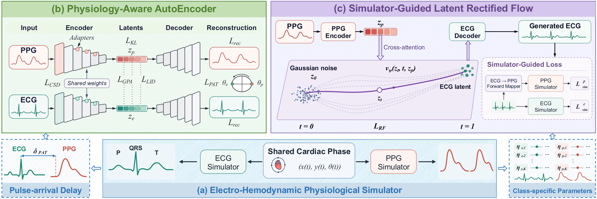
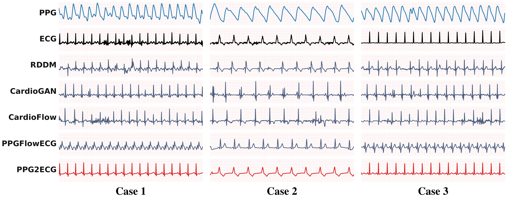

# [NeurIPS 2026] PPG2ECG: Physiology-Guided Latent Rectified Flow for Electro-Hemodynamic PPG-to-ECG Generation



## Overview

PPG2ECG generates ECG from PPG with a physiology-guided latent rectified flow, built from three components:

- **(a) Electro-Hemodynamic Physiological Simulator**: co-models ECG and PPG through shared cardiac phase dynamics.
- **(b) Physiology-Aware AutoEncoder**: learns an aligned electro-hemodynamic latent space for PPG and ECG.
- **(c) Simulator-Guided Latent Rectified Flow**: generates ECG latents conditioned on PPG, regularized by ECG morphology and ECG-to-PPG hemodynamic consistency.

Experiments on the large-scale MC-MED dataset show improved PPG-to-ECG generation and downstream cardiovascular disease classification.

## Case Studies



Three held-out 10-second MC-MED windows from different patients, comparing PPG2ECG (red) with four baselines.

| | Case 1 | Case 2 | Case 3 |
| :-- | :-: | :-: | :-: |
| Reference ECG | Noisy, 107 bpm | Broad QRS, 60 bpm | Regular rhythm, 99 bpm |
| PPG2ECG (Pearson *r*) | **0.84** | **0.90** | **0.93** |

PPG2ECG follows the reference beat timing and waveform shape in all three cases, while the baselines often miss the reference peaks (*r* ≤ 0.21).

## Model Parameters

Pretrained model parameters are available upon request.
Please email xiaoda.wang@emory.edu and briefly describe your intended use.

## Citation

If you find our work useful in your study, please cite:

```bibtex
@inproceedings{wang2026ppg2ecg,
  title={PPG2ECG: Physiology-Guided Latent Rectified Flow for Electro-Hemodynamic PPG-to-ECG Generation},
  author={Wang, Xiaoda and Wang, Minxiao and Han, Kaiqiao and Cao, Defu and Chang, Ching and Shi, Yidan and Yan, Runze and Luo, Xiao and Liu, Yan and Hu, Xiao and Sun, Yizhou and Wang, Wei and Yang, Carl},
  booktitle={The Fortieth Annual Conference on Neural Information Processing Systems},
  year={2026}
}
```
